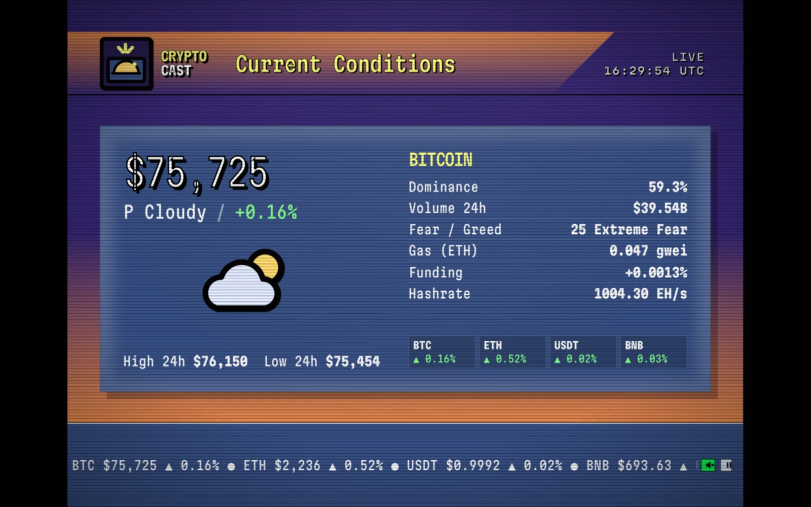
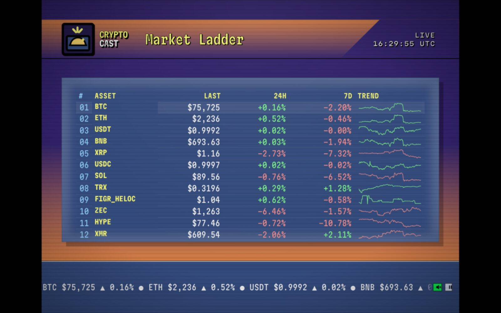
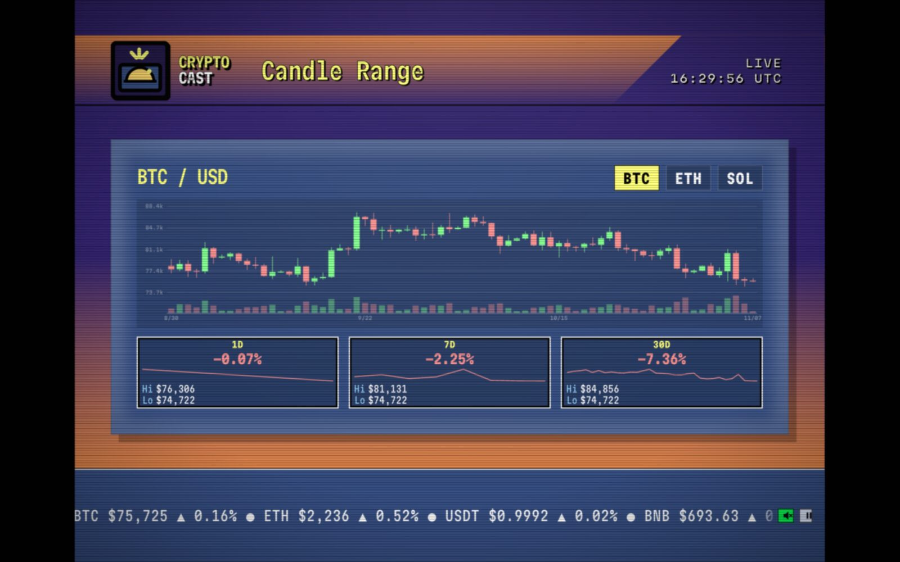
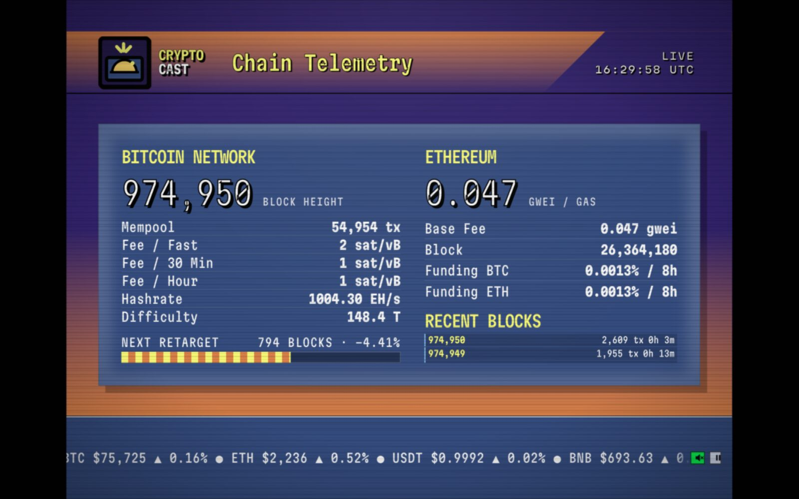
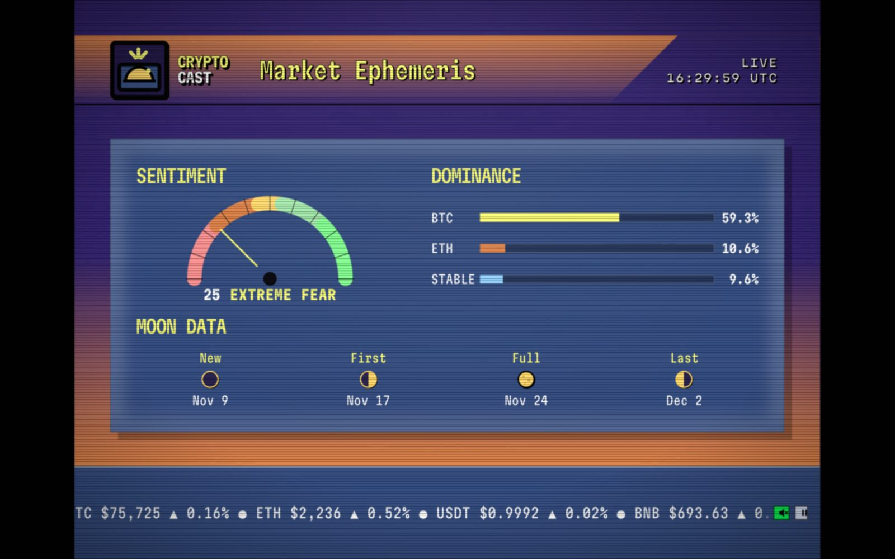

# CRYPTOCAST

**A live crypto broadcast in the body of a 1993 weather channel.**

Live prices, chain telemetry, funding, sentiment and moon phases rendered on a
4:3 cathode-ray stage: purple field, orange header gradient, navy data panels,
yellow captions, black keylines. Six screens, eleven-second rotation, synthesized
cable-box audio. Real data. No build step. No backend.

**[dellyty.github.io/crypto-retro](https://dellyty.github.io/crypto-retro/)**



---

## What it is

The reference is the WeatherStar local forecast segment — the dense, high-contrast,
information-first screen that ran on cable before the web ate the interface. CRYPTOCAST
keeps that grammar and applies it to market data: twenty numbers per screen, readable
from across a room in four seconds, no scrolling, no cards, no glow.

It is also a genuinely fast dashboard. ~60 KB of JS+CSS, one 38 KB font, boots from a
cached snapshot in one frame, works after first load with no network.

| | |
|---|---|
| **Screens** | Conditions · Market Ladder · Candle Range · Chain Telemetry · Market Ephemeris · Discussion |
| **Data** | CoinGecko, Coinbase Exchange, mempool.space, drpc (ETH JSON-RPC), Hyperliquid, alternative.me |
| **Dependencies** | none at runtime |
| **Build** | none — `docs/` is deployed verbatim |
| **Hosting** | GitHub Pages, `main` → `/docs` |
| **Keys / accounts** | none |

## Deploy

Pages serves `main` → `/docs` directly. No build, no artifact upload, and no
Actions token scope required — push and the site is live in about a minute.

Optional CI: `ci/checks.yml` runs the tests, the invariant checker and a boot
smoke test on every push. Enable it with:

```bash
mkdir -p .github/workflows && cp ci/checks.yml .github/workflows/
```

Then commit and push with a token that has the `workflow` scope.

## Run it

```bash
git clone https://github.com/Dellyyty/crypto-retro
cd crypto-retro
npm start          # → http://localhost:8080
```

Any static server works; `tools/serve.mjs` just sets the right MIME types for ES
modules and woff2.

```bash
npm test           # 26 pure-function tests, node --test
npm run check      # repo invariants: no placeholders, assets resolve, CSS balanced
npm run og         # re-render og.png + icons (needs rsvg-convert or ImageMagick)
```

## Controls

| Key | Action |
|---|---|
| `1`–`6` | Jump to a screen |
| `←` `→` | Previous / next screen |
| `↑` `↓` | Chart asset (BTC / ETH / SOL) |
| `space` | Pause or resume rotation |
| `m` | Mute or unmute audio |
| `Enter` | Start from the title card |

Deep links: `#conditions`, `#markets`, `#chart`, `#network`, `#ephemeris`,
`#discussion`. Add `?direct` to skip the title card:
`index.html?direct#network`.

## Screens

| | |
|---|---|
|  |  |
| **Market Ladder** — top twelve, one screen | **Candle Range** — 70 daily candles + window cards |
|  |  |
| **Chain Telemetry** — blocks, fees, gas, funding | **Market Ephemeris** — fear & greed, dominance, moon |

**1 · Conditions** — BTC price, the market's "weather" derived from 24h change
(a fixed ladder, not a model), 24h range, dominance, volume, fear & greed, gas,
perpetual funding, hashrate.

**2 · Market Ladder** — top twelve assets: last, 24h, 7d, seven-day sparkline. One
screen, no scroll.

**3 · Candle Range** — 70 daily candles from Coinbase spot for BTC/ETH/SOL, with
volume, plus 1D/7D/30D change cards laid out like a five-day forecast.

**4 · Chain Telemetry** — Bitcoin block height, mempool backlog, three fee tiers,
hashrate, difficulty, retarget progress; Ethereum gas and base fee; BTC/ETH perp
funding.

**5 · Market Ephemeris** — Fear & Greed gauge, dominance bars, and real moon phases
(synodic month from a known new moon).

**6 · Discussion** — the narrative screen, written the way a local forecaster reads
it, plus a halving countdown computed from the block height.

## Architecture

```
docs/                      deployed verbatim — no build step
├── index.html             broadcast shell + SVG sprite
├── about.html             what/why
├── data.html              endpoint provenance, formatting contract
├── infra.html             deploy topology, rendering model, failure model
├── design.html            palette, type, geometry, motion rules
├── styles/
│   ├── broadcast.css      CRT stage, 4:3 scaling, container queries
│   └── docs.css           documentation pages
├── scripts/
│   ├── app.js             controller: rotation, render, input, canvas painting
│   └── lib/
│       ├── api.js         fetch + normalize + cache (null on failure, never fake)
│       ├── format.js      pure formatters (usd, pct, gwei, hashrate, …)
│       ├── conditions.js  price → weather ladder
│       ├── charts.js      canvas: candles, sparkline, gauge
│       ├── astro.js       moon phase, halving math
│       └── audio.js       Web Audio ambience + cues
└── assets/                font (+ OFL), icons, og.png, manifest, sw.js
tests/pure.test.mjs        26 tests over the pure modules
tools/                     serve.mjs · check.mjs · og.mjs · 404.mjs
ci/checks.yml              CI definition (install with one command, see below)
```

Decisions worth knowing:

- **No framework, no bundler.** The whole app is ~1,600 lines. Debuggable in
  production, zero supply chain, instant cold start.
- **`—` is load-bearing.** A zero is a claim; an em dash is an absence. No formatter
  ever returns a fabricated default, and a failed fetch skips the affected panel
  instead of inventing a number.
- **State is one object**, written only by `api.js`, rendered by pure-ish functions.
  Six screens all live in the DOM; rotation toggles `hidden`.
- **Canvas painting is layout-gated.** A detached or hidden canvas reports a bogus
  box (300×150 default, or 0×0); painting there bakes a bitmap at the wrong scale.
  Every draw is committed only after `getComputedStyle` agrees with the used box.
- **Deep links are captured before init**, because the controller rewrites the hash
  to the current screen on first paint.
- **The narrative auto-fits**: it gives up type size and leading, never lines.

Full detail: [infra.html](https://dellyty.github.io/crypto-retro/infra.html) ·
[data.html](https://dellyty.github.io/crypto-retro/data.html) ·
[design.html](https://dellyty.github.io/crypto-retro/design.html)

## Failure behavior

| Condition | Result |
|---|---|
| One API fails / times out (12 s) | That panel keeps its last value; sweep continues |
| All market APIs down | Plays from cached snapshot, metadata reads `REPLAY` |
| First visit, no network | Em dashes, `NO SIGNAL` in the chart, broadcast still runs |
| `localStorage` blocked | Cache writes no-op; live data still renders |
| No Web Audio | Silent broadcast; mute stays inert instead of lying |
| `prefers-reduced-motion` | Turn-on, wipes, marquee, flicker disabled |

## Data & honesty

All endpoints are public, keyless, and CORS-enabled. Prices are CoinGecko aggregates
(they will not match your venue to the cent); candles are Coinbase spot only; funding
is Hyperliquid normalized to 8 h. Refresh is 60 s for markets/chain, 5 min for candles.

**Not financial advice.** No signals, no predictions, no wallets, no accounts, no
tracking. The only storage is a local snapshot cache.

## Credits

Martian Mono by Evil Martians, SIL Open Font License 1.1 (`docs/assets/fonts/OFL.txt`).
All icons, the logo and backgrounds are original SVG/CSS in this repo — nothing is
traced from a broadcast recording. The aesthetic is a homage to WeatherStar-era
graphics hardware; this project is not affiliated with The Weather Channel.

MIT © Dellyyty
